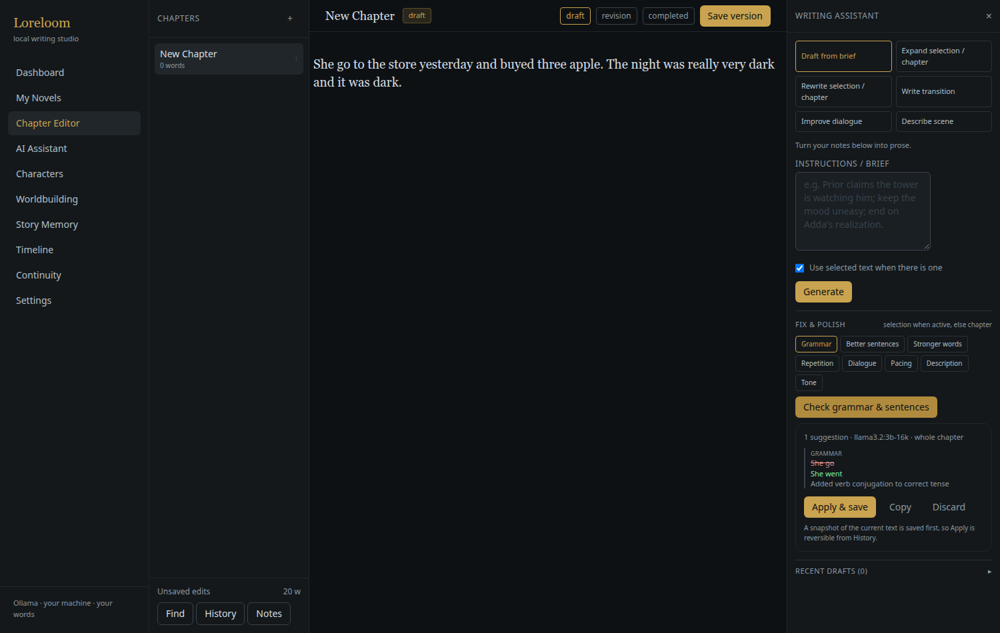

# Loreloom

A local-first AI novel-writing environment, powered by **Ollama** on your own machine.

> The author controls the story. The AI assists.

Loreloom combines a professional writing environment (novels, chapters, versions,
export) with specialised AI capabilities (writing assistant, AI editor, agent-run
memory extraction, continuity checking, brainstorming, semantic story memory).
Manuscripts, characters, worldbuilding and memory live in a single
local SQLite database — no cloud, no paid APIs, no telemetry.

## Screenshots

The chapter editor is the workspace: chapters on the left, the manuscript in the
middle, and AI tools on the right. **Fix & polish** turns a grammar pass into an
explicit list of before → after changes; nothing is written until you click Apply,
and Apply snapshots first so it is reversible from History.



## Requirements

- Node.js 20+ (developed and tested on Node 22)
- [Ollama](https://ollama.com) installed **and running** (`ollama serve` or the desktop app)
- Disk space for models (see below)

## Quick start

```bash
npm install            # first time only
npm run dev            # starts server (:4747) + Vite dev client (:5173)
# open http://localhost:5173
```

Production-style single process (serves the built client from the server):

```bash
npm run build && npm start
# open http://localhost:4747
```

Then open **Settings → Ollama engine**, confirm it shows *connected*, install models
from the UI, **Test generation**, and pick your task models in **Model routing**.
Everything afterwards works from the sidebar.

## Models (chosen for your hardware)

Loreloom detects your CPU/RAM/GPU and recommends accordingly. On a 7 GB-RAM,
CPU-only laptop that means roughly ≤4B-parameter quantized models:

| Tier | Purpose | Recommended | Size |
|---|---|---|---|
| Main | prose, editing, continuity, brainstorming | `qwen3:4b` (Q4_K_M) | 2.3 GB |
| Light | summaries, memory extraction, quick checks | `llama3.2:3b` | ~2 GB |
| Embeddings | semantic story-memory search | `nomic-embed-text` | 0.27 GB |

Any Ollama model can be assigned to any slot in Settings (**Model routing → auto or
manual**); you are never locked to a specific model.

> Known issue: on some Ollama builds, qwen3-family models emit their reasoning
> ("Hmm, the user asked…") into the normal output instead of a thinking channel,
> even with `think: false`. If you see that happen in Loreloom's writing output,
> assign `llama3.2:3b` (or another instruct model) to both tiers — the app's model
> routing fallback already prefers it automatically.

## Project layout

```
docs/ARCHITECTURE.md       # stack, DB schema, agents, Ollama plan
docs/FEATURES.md           # verified feature ledger (kept honest)
docs/API.md                # HTTP endpoints and streaming format
docs/TROUBLESHOOTING.md    # common failures and recovery steps
docs/ROADMAP.md            # phase-by-phase build plan
server/                    # Express + TypeScript API, SQLite, Ollama client, agents
client/                    # Vite + React + Tailwind + CodeMirror editor
client-dist/               # built client (served by the server in production)
server/data/               # loreloom.db + rolling backups/ (gitignored)
```

Also see [CONTRIBUTING.md](CONTRIBUTING.md) for development setup and
[SECURITY.md](SECURITY.md) for the threat model (short version: local only, no
accounts, never expose the port).

## Key behaviours

- **Autosave** every ~1.2 s of idle typing; snapshots accrue in revision history
  (also always before manual edits and restores). Restores are reversible.
- **Story Memory buckets**: Confirmed Canon / Temporary Notes / AI Suggestions /
  Unresolved Questions / Rejected Ideas. AI-suggested facts stay in their bucket
  until you approve them; only Canon is injected into AI prompts as binding.
- **Semantic retrieval**: chapters, memory, characters and world entries are
  embedded locally; each AI request receives a compact retrieved context, never
  the whole manuscript. Without an embedding model the same search degrades to
  keyword matching.
- **Task queue**: heavy generation runs one at a time; light tasks overlap up to a
  small cap (tunable in Settings). Every generation streams and can be cancelled.
- **Privacy**: the app talks only to `localhost:11434` (Ollama) and the Ollama
  registry when *you* click a model download. Nothing is uploaded, ever.

## Backups

`server/data/backups/` keeps a rolling snapshot taken at every server start
(last 10) plus manual snapshots from **Settings → Backups**, where you can also
restore a file (restart Loreloom after restoring).

## Scripts

| Command | Purpose |
|---|---|
| `npm run dev` | dev server + Vite with hot reload |
| `npm run build` | typecheck server + build client |
| `npm start` | build + serve everything on :4747 |
| `npm run typecheck` | TypeScript for both workspaces |
| `npm test` | 53-test suite against an isolated throwaway instance (real project data is never touched) |
